# RIR-API

API REST para procesamiento y analisis de respuestas al impulso segun la norma ISO 3382.

<!-- Badge de CI: reemplazar <usuario>/<repo> por los datos del repositorio del grupo -->


## Descripcion

RIR-API es el trabajo practico de Senales y Sistemas (UNTREF, 2C 2026): una API REST
(FastAPI) con la cadena completa de procesamiento acustico, desde la generacion de senales
de excitacion hasta el calculo de parametros acusticos (EDT, T20, T30, D50, C80) segun
ISO 3382-1.

- Consigna, especificaciones y ruta del TP: <https://maxiyommi.github.io/signal-systems/trabajo_practico/ruta/>
- API de referencia de la catedra (Swagger UI): <https://rir-api.onrender.com/docs>

## Integrantes

| Nombre | Legajo | Rol |
|--------|--------|-----|
| Joaquin Vargas | 70837 | Tester |
| Rodrigo Sanchez | 52065 |  API Developer |
| Agustin Quaglia | 71839 | Reviewer |
| Mauro Zampietri | 61508 | Release Manager |

## Requisitos previos

- Python 3.12 o superior
- [uv](https://docs.astral.sh/uv/) (gestor de paquetes y entornos virtuales)
- git y una cuenta de GitHub

## Instalación y Ejecución

1. **Clonar el repositorio:**
   ```bash
   git clone https://github.com/kowa2003/SyS-Trabajo-Practico-API-GRUPO-2.git
   cd SyS-Trabajo-Practico-API-GRUPO-2
   ```

2. **Instalar las dependencias del entorno con `uv`:**
   ```bash
   uv sync
   ```

3. **Levantar el servidor de desarrollo (FastAPI):**
   ```bash
   uv run uvicorn app.main:app --reload
   ```
   La API quedará disponible en `http://localhost:8000` (endpoint de verificación en `/health` y documentación interactiva en `/docs`). Documentacion interactiva:

- Swagger UI: `http://localhost:8000/docs`
- ReDoc: `http://localhost:8000/redoc`

4. **Ejecutar la suite de pruebas:**

   ```bash
   uv run pytest
   ```
### Convención de Commits (Conventional Commits)

En este repositorio utilizamos la especificación **[Conventional Commits v1.0.0](https://www.conventionalcommits.org/es/v1.0.0/)** para mantener un historial de cambios claro, estructurado y fácil de revisar en cada Pull Request.

#### Estructura del mensaje

Todo mensaje de commit debe seguir el siguiente formato:

```text
<tipo>(<ámbito opcional>): <descripción breve en minúscula>

[cuerpo opcional con más detalles]

[nota de pie opcional, ej: Closes #issue]
```

#### Tipos de commit permitidos

| Tipo | Uso principal | Ejemplo en este proyecto |
| :--- | :--- | :--- |
| **`feat`** | Nueva funcionalidad en el código | `feat(services): implementar generador en pink_noise.py` |
| **`fix`** | Corrección de un bug o error | `fix(acoustics): corregir cálculo de parámetros en banda única` |
| **`docs`** | Cambios exclusivos en la documentación | `docs(readme): actualizar diagrama de arquitectura y guía de instalación` |
| **`test`** | Agregado o ajuste de pruebas con `pytest` | `test(filters): agregar test unitario para filter_single_band` |
| **`refactor`** | Mejora de código sin cambiar su comportamiento | `refactor(schemas): limpiar modelos en responses.py` |
| **`chore`** | Tareas de mantenimiento, configuración o limpieza | `chore: eliminar archivo de prueba Test_1` |
| **`ci`** | Cambios en flujos de integración continua | `ci(actions): configurar ejecución automática de pytest` |

#### Reglas rápidas para el equipo

1. **Usar verbos en infinitivo o imperativo** en la descripción, sin punto final (ej. `agregar`, `corregir`, `actualizar`).
2. **Cambios que rompen compatibilidad (*Breaking Changes*):** Si un cambio modifica el formato de entrada/salida de un endpoint existente, se agrega un signo `!` después del tipo/ámbito (ej. `feat(api)!: cambiar formato de salida en /acoustics/parameters`).
3. **Vincular con Issues:** Si el commit resuelve un Issue del proyecto, referenciarlo al final (ej. `feat(services): agregar función generate_synthetic_ir (#8)`).

#### Ejemplo de uso por consola

```bash
git switch develop
git pull origin develop
git switch -c feature/pink-noise

# Después de implementar la funcionalidad
git add app/services/pink_noise.py
git commit -m "feat(services): implementar generacion de ruido rosa"
git push -u origin feature/pink-noise
```
Después del push, abrir un Pull Request desde `feature/pink-noise` hacia `develop`.
## Estructura del proyecto

```
rir-api/
├── app/
│   ├── __init__.py
│   ├── main.py                    # Punto de entrada FastAPI (/ y /health)
│   ├── settings.py                # Configuracion (pydantic-settings, variables RIR_*)
│   ├── routers/
│   │   ├── __init__.py
│   │   ├── health.py              # GET /health (M0)
│   │   └── audio_http.py          # wav_response y uploaded_file (ya resueltas)
│   │   └── signals.py             # Endpoints de generación (M1)
│   ├── schemas/
│   │   └── __init__.py            # Modelos Pydantic de request/response (desde M1)
│   │   └── responses.py
│   │   └── signals.py             # Modelos de entrada (M1)
│   └── services/
│       ├── __init__.py
│       ├── pink_noise.py          # generate_pink_noise (M1)
│       ├── sine_sweep.py          # generate_sine_sweep_pair (M1)
│       ├── audio_io.py            # play_and_record (M1)
│       ├── signal_utils.py        # load_audio, generate_synthetic_ir, get_impulse_response,
│       │                          # logarithmic_scale_conversion (M2)
│       ├── filter.py              # filter_single_band (M2)
│       └── acoustic_parameters.py # apply_smoothing, apply_schroeder_integral, linear_regression,
│                                  # calculate_parameters_from_ir, apply_lundeby (M3)
├── tests/
│   ├── data/                      # WAV chicos de prueba (se versionan)
│   ├── test_placeholder.py        # Test trivial (M0)
│   ├── test_generacion.py         # Tests de M1
│   ├── test_procesamiento.py      # Tests de M2
│   ├── test_analisis.py           # Tests de M3 (services)
│   └── test_api.py                # Tests de endpoints, por milestone (M0 a M3)
├── data/                          # Mediciones y audios locales (ignorado por git)
├── docs/
│   └── README.md                  # Guia para la documentacion (graficas de validacion, etc.)
│   └── m1/                       
│        ├── espectro_ruido_rosa.png
│        ├── espectrograma_sine_sweep.png
│        ├── convolucion_sweep_filtro_inverso.png
│        ├── prueba_grabacion.py
│        ├── grafica_grabacion.py
│        ├── grabacion_real_m1.wav
│        └── grabacion_real.png
├── .github/workflows/ci.yml       # CI: ruff + pytest en cada push/PR
├── .gitignore
├── pyproject.toml                 # Dependencias y configuracion (ruff, pytest)
└── README.md
```

Cada milestone expone lo que construye: los routers y schemas de `signals` se agregan en M1
(y suman `synthetic-ir` en M2), los de `filters` en M2 y los de `acoustics` y `utils` en M3
(ver los `TODO` en `app/main.py`).

## Diagrama de arquitectura

```mermaid
flowchart TB
    %% Colores originales
    classDef m0 stroke:#3b82f6,stroke-width:3px
    classDef m1 stroke:#a855f7,stroke-width:3px
    classDef m2 stroke:#22c55e,stroke-width:3px
    classDef m3 stroke:#f97316,stroke-width:3px

    subgraph Leyenda["Leyenda de Colores (Hitos)"]
        direction LR
        Leg0["M0: El plano"]:::m0 ~~~ Leg1["M1: Generación"]:::m1 ~~~ Leg2["M2: Procesamiento"]:::m2 ~~~ Leg3["M3: Producto final"]:::m3
    end

    C["<b>Cliente</b><br/>Swagger · frontend · script"]:::m0

    subgraph API["RIR-API (FastAPI)"]
        direction TB

        subgraph R["<b>Routers</b> (app/routers/)"]
            RH["health.py<br/>GET /health"]:::m0
            RAudio["audio_http.py<br/>wav_response<br/>uploaded_file"]:::m0
            RSignals["<b>signals.py</b><br/><span style='color:#a855f7'>POST /signals/pink-noise</span><br/><span style='color:#a855f7'>POST /signals/sine-sweep</span><br/><span style='color:#22c55e'>POST /signals/synthetic-ir</span>"]
            RFilters["filters.py<br/>POST /filters/single-band"]:::m2
            RUtils["utils.py<br/>POST /utils/smoothing<br/>POST /utils/schroeder<br/>POST /utils/lundeby"]:::m3
            RAcoustics["acoustics.py<br/>POST /acoustics/parameters"]:::m3
        end

        subgraph SC["<b>Schemas</b> (app/schemas/)"]
            SResponses["<b>responses.py</b><br/><span style='color:#3b82f6'>HealthResponse</span><br/><span style='color:#22c55e'>BandAnalysisResponse</span>"]
            SSignals["<b>signals.py</b><br/><span style='color:#a855f7'>PinkNoiseRequest</span><br/><span style='color:#a855f7'>SineSweepRequest</span><br/><span style='color:#22c55e'>SyntheticIRRequest</span>"]
            SUtils["utils.py<br/>SmoothingRequest<br/>SchroederResponse<br/>LundebyResponse"]:::m3
        end

        subgraph SV["<b>Services</b> (app/services/)"]
            PN["pink_noise.py<br/>generate_pink_noise"]:::m1
            SW["sine_sweep.py<br/>generate_sine_sweep_pair"]:::m1
            IO["audio_io.py<br/>play_and_record"]:::m1
            SU["signal_utils.py<br/>load_audio<br/>generate_synthetic_ir<br/>get_impulse_response<br/>logarithmic_scale_conversion"]:::m2
            SF["filter.py<br/>filter_single_band"]:::m2
            AP["acoustic_parameters.py<br/>apply_smoothing<br/>apply_schroeder_integral<br/>linear_regression<br/>calculate_parameters_from_ir<br/>apply_lundeby"]:::m3
        end
    end

    subgraph L["<b>Librerías</b>"]
        direction LR
        L_FA["FastAPI"]:::m0 ~~~ L_PY["Pydantic"]:::m0 ~~~ L_NP["NumPy"]:::m1 ~~~ L_SP["SciPy"]:::m1 ~~~ L_SD["sounddevice"]:::m1 ~~~ L_SF["soundfile"]:::m1
    end

    %% Entradas del cliente
    C -->|"HTTP + JSON"| RSignals
    C -->|"HTTP + JSON"| RUtils
    C -->|"HTTP + WAV"| RFilters
    C -->|"HTTP + WAV"| RAcoustics
    C --> RH

    %% Validaciones y llamadas a servicios
    RSignals -->|"valida con"| SSignals
    RSignals -->|"llama a"| PN
    RSignals -->|"llama a"| SW
    RSignals -->|"llama a"| SU

    RFilters -->|"llama a"| SF

    RUtils -->|"valida con"| SUtils
    RUtils -->|"llama a"| AP

    %% Análisis acústico: conexiones faltantes
    RAcoustics -->|"load_audio"| SU
    RAcoustics -->|"filter_single_band"| SF
    RAcoustics -->|"calcula parámetros"| AP
    RAcoustics -->|"BandAnalysisResponse"| SResponses

    %% Respuestas al cliente
    RH -->|"JSON"| C
    RUtils -->|"JSON"| C
    RAcoustics -->|"JSON"| C

    RSignals -->|"WAV"| RAudio
    RFilters -->|"WAV"| RAudio
    RAudio -->|"WAV al cliente"| C

    %% Dependencias de librerías
    RSignals -.-> L_FA
    SSignals -.-> L_PY
    SResponses -.-> L_PY
    SUtils -.-> L_PY

    PN --> L_NP
    SW --> L_NP
    SW --> L_SP
    IO --> L_SD
    SU --> L_NP
    SF --> L_SP
    AP --> L_NP
    RAudio --> L_SF
```
## Branching Strategy

El equipo utiliza Feature Branches y Pull Requests,
con una rama de integración antes de cada entrega.

### Rama principal (`main`)
Contiene las versiones estables y entregables del proyecto.
No se permiten pushes directos. Los cambios ingresan
mediante Pull Requests revisados y con CI aprobado.

### Rama de integración (`develop`)
Reúne las funcionalidades desarrolladas por el equipo.
Se utiliza para ejecutar pruebas de integración antes
de incorporar los cambios a `main`.

### Ramas de trabajo
Cada tarea o issue se desarrolla en una rama independiente,
creada preferentemente desde `develop`.

Convenciones de nombres:
- `feature/nombre`: nuevas funcionalidades.
- `fix/nombre`: correcciones de errores.
- `docs/nombre`: documentación.
- `test/nombre`: pruebas automatizadas.

### Flujo de trabajo
1. Crear una rama desde `develop`.
2. Implementar los cambios y realizar commits descriptivos.
3. Abrir un Pull Request hacia `develop`.
4. Verificar Ruff, Pytest y la revisión de un compañero.
5. Integrar los cambios en `develop`.
6. Para cada entrega, abrir un PR de `develop` hacia `main`.
7. Una vez aprobado, realizar el merge y crear el tag
   correspondiente al milestone.

Se utiliza la convención Conventional Commits.

## Ejemplos de uso con curl

Con el servidor en ejecución, se pueden generar
señales WAV mediante peticiones HTTP.

### Generar ruido rosa (M1)

```bash
curl -X POST http://localhost:8000/api/v1/signals/pink-noise \
  -H "Content-Type: application/json" \
  -d '{"duration": 5, "sample_rate": 44100}' \
  -o pink_noise.wav
```

### Generar sine sweep (M1)

```bash
curl -X POST http://localhost:8000/api/v1/signals/sine-sweep \
  -H "Content-Type: application/json" \
  -d '{"duration": 3, "start_freq": 20, "end_freq": 20000, "sample_rate": 44100, "inverse": false}' \
  -o sine_sweep.wav
```

Para obtener el filtro inverso, se repite la
segunda petición con `inverse: true` y se guarda
el archivo como `inverse_filter.wav`.

### Generar respuesta al impulso sintética (M2)

Genera una respuesta al impulso sintética con tiempos de
reverberación (T60) configurables por banda de octava.
El resultado se descarga como un archivo WAV.

```bash
curl -X POST http://localhost:8000/api/v1/signals/synthetic-ir \
  -H "Content-Type: application/json" \
  -d '{"duration": 3.0, "t60_values": {"125": 2.0, "500": 1.5, "1000": 1.2, "4000": 0.8}, "sample_rate": 44100}' \
  -o synthetic_ir.wav
```

### Filtrar un WAV por banda de octava (M2)

Recibe un archivo WAV, lo filtra alrededor de una frecuencia
central y devuelve el audio filtrado.

En este ejemplo se usa la RI sintética generada anteriormente,
con un filtro de cuarto orden centrado en 1000 Hz.

```bash
curl -X POST http://localhost:8000/api/v1/filters/single-band \
  -F "file=@synthetic_ir.wav" \
  -F "center_freq=1000" \
  -F "order=4" \
  -o banda_1000hz.wav
```

El parámetro `order` es opcional y su valor predeterminado
es 4. Si el archivo enviado no contiene audio válido, el
endpoint devuelve HTTP 422.
  
## Milestones y entregas (2C 2026)

| Milestone | Entrega | Tag | Evaluacion |
|-----------|---------|-----|------------|
| **M0 · El plano** (arquitectura) | mie 7/10 (asincronica, por Slack/GitHub) | — | Seguimiento, sin nota |
| **M1 · Generacion de senales** | mie 28/10 (en clase) | `v0.1.0` | Seguimiento, sin nota |
| **M2 · Procesamiento de la RI** | mie 4/11 | `v0.2.0` | Seguimiento, sin nota |
| **M3 · Producto final** + presentacion oral | mie 18/11 | `v1.0.0` | **Nota del TP: 60 % M3 + 40 % oral** |

- No hay informe escrito: la validacion de resultados va en una seccion **"Validacion"** de
  este README.
- **`AI_LOG.md`** en la raiz del repositorio es **obligatorio** (sin nota propia, pero sin
  `AI_LOG.md` M3 no se considera completo): registren el uso de herramientas de IA durante
  todo el proyecto.
- Detalle de cada milestone: <https://maxiyommi.github.io/signal-systems/trabajo_practico/ruta/>

### M0 · El plano

- [x] Repositorio del grupo creado a partir del template, con los docentes como colaboradores.
- [x] `uv sync`, `uv run uvicorn app.main:app --reload` y `uv run pytest` funcionan.
- [x] README con integrantes y roles, instalacion, estructura y branching strategy.
- [x] Diagrama de arquitectura (Mermaid o draw.io) con todos los modulos de M1, M2 y M3.
- [x] Al menos 10 issues con labels (`milestone-1`, `milestone-2`, `milestone-3`) y asignados.

### M1 · Generacion de senales (`v0.1.0`)

- [x] `generate_pink_noise()` en `app/services/pink_noise.py` (Voss-McCartney recomendado).
- [x] `generate_sine_sweep_pair()` (sweep + filtro inverso) en `app/services/sine_sweep.py`.
- [x] `play_and_record()` en `app/services/audio_io.py`.
- [x] Endpoints `POST /api/v1/signals/pink-noise` y `POST /api/v1/signals/sine-sweep` (devuelven WAV),
      con sus schemas en `app/schemas/signals.py`.
- [x] Tests de `tests/test_generacion.py` y los de M1 en `tests/test_api.py` pasando;
      graficas de validacion en `docs/m1/`.

### M2 · Procesamiento de la RI (`v0.2.0`)

- [x] `load_audio()`, `generate_synthetic_ir()`, `get_impulse_response()` y
      `logarithmic_scale_conversion()` en `app/services/signal_utils.py`.
- [x] `filter_single_band()` en `app/services/filter.py`.
- [x] Endpoints `POST /api/v1/signals/synthetic-ir` y `POST /api/v1/filters/single-band`
      (recibe un WAV subido).
- [x] Tests de `tests/test_procesamiento.py` y los de M2 en `tests/test_api.py` pasando.

### M3 · Producto final (`v1.0.0`)

- [x] `apply_smoothing()`, `apply_schroeder_integral()`, `linear_regression()` y
      `calculate_parameters_from_ir()` en `app/services/acoustic_parameters.py`.
- [x] Endpoints `POST /api/v1/acoustics/parameters`, `POST /api/v1/utils/schroeder` y
      `POST /api/v1/utils/smoothing`: la API completa.
- [x] Tests de `tests/test_analisis.py` y todos los de `tests/test_api.py` pasando.
- [x] Seccion "Validacion" en este README, `AI_LOG.md` y presentacion oral.
- [ ] (Opcional) `apply_lundeby()`.

## Validacion M1

### Ruido rosa:

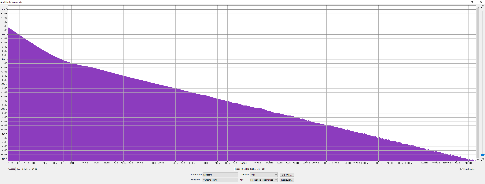

Pendiente medida: aprox. -25 dB (100 Hz), -35 dB (1 kHz) y -45 dB (10 kHz),
es decir, unos -10 dB/decada (≈ -3 dB/octava).

### Respuesta en frecuencia del sweep, convolución y filtro inverso:

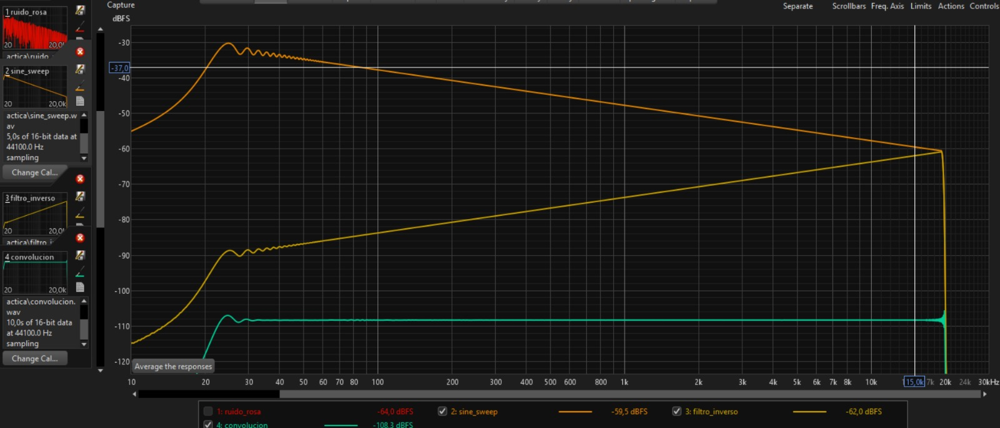

### Convolucion del sweep con su filtro inverso:


### Espectograma del sine sweep:

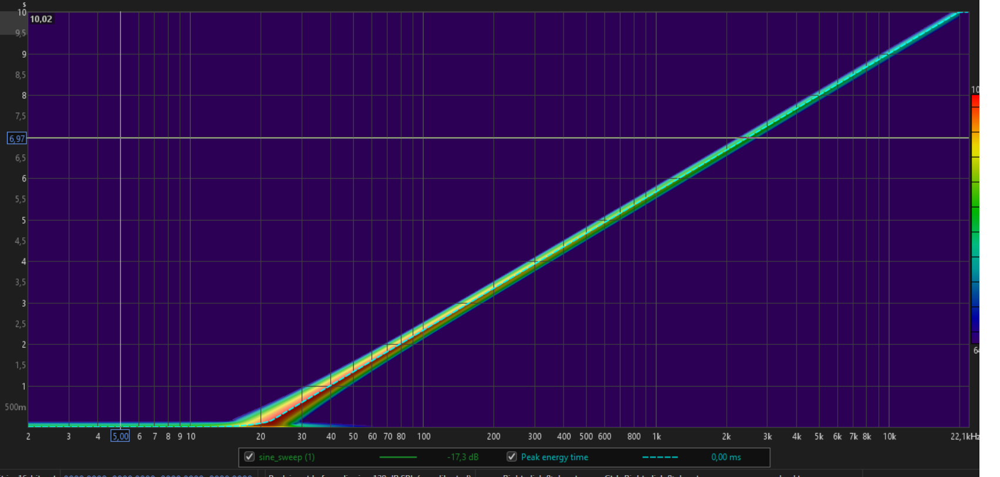

### Prueba real de reproducción y grabación

Se realizó una prueba utilizando los servicios
`generate_sine_sweep_pair()` y `play_and_record()`.

**Configuración:**

- Señal: sine sweep logarítmico de 100 Hz a 5000 Hz.
- Frecuencia de muestreo: 44100 Hz.
- Duración del sweep: 3 segundos.
- Duración total de grabación: 5 segundos.
- Silencio inicial: 0,5 segundos.
- Silencio posterior: 1,5 segundos.
- Factor de amplitud aplicado al sweep: 0,2.
- Dispositivo de reproducción: Main Left/Right (MiniFuse 4).
- Dispositivo de grabación: Mic/Line/Inst 1-2 (MiniFuse 4).
- Canales de reproducción: 1 (mono).
- Canales de grabación: 1 (mono).
- Buffer: `sd.default.blocksize = 0`
  (tamaño de bloque automático, elegido por PortAudio).

**Resultado:**

La ejecución finalizó y generó un archivo WAV con 220500 muestras
y un canal, correspondiente a 5 segundos de grabación a 44100 Hz.

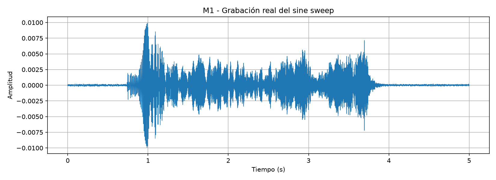

[Archivo WAV de la grabación](docs/m1/grabacion_real_m1.wav)

[Configuración y resultados de la prueba](docs/m1/configuracion_grabacion_m1.txt)

## Validación Acústica y Procesamiento Multi-banda (Milestone 2)

Para la validación del pipeline del Milestone 2, se procesaron dos respuestas al impulso (RIs) de recintos reales pertenecientes al **MIT IR Survey** (MIT McDermott Lab):
1. **Hallway Elementary School** (`h042_Hallway_ElementarySchool_4txts.wav`): Recinto reverberante con $T_{60}$ largo.
2. **Livingroom** (`h045_Livingroom_4txts.wav`): Recinto pequeño y absorbente con $T_{60}$ corto.

- **Página del MIT IR Survey:** https://mcdermottlab.mit.edu/Reverb/IR_Survey.html
- **Descarga de los archivos de audio:** https://mcdermottlab.mit.edu/Reverb/IRMAudio/Audio.zip

Ambas RIs fueron procesadas mediante el módulo de filtrado por octava (`filter_single_band`) y conversión logarítmica (`logarithmic_scale_conversion`) en las seis frecuencias centrales normalizadas según IEC 61260 ($125, 250, 500, 1000, 2000\text{ y }4000\text{ Hz}$). Se generaron representaciones temporales, espectrales y multibanda para inspeccionar las señales procesadas. Además, se incluyen mediciones obtenidas con el software de referencia **REW (Room EQ Wizard)**, basadas en parámetros acústicos de referencia de la norma ISO 3382.

---

### 1. Parámetros Numéricos de Referencia (REW - ISO 3382)

#### Tabla A: Hallway Elementary School (`h042`)
*Transcripción de parámetros extraídos de Room EQ Wizard:*

| Parámetro / Banda (Hz) | 125 Hz | 250 Hz | 500 Hz | 1000 Hz | 2000 Hz | 4000 Hz |
| :--- | :---: | :---: | :---: | :---: | :---: | :---: |
| **EDT (s)** | 1,400 | 1,523 | 1,204 | 1,186 | 0,904 | 0,087 |
| **T20 (s)** | 1,648 | 2,236 | 2,205 | 2,177 | 1,821 | 1,043 |
| **T30 (s)** | 1,708 | 2,274 | 2,237 | 2,252 | 1,945 | 1,147 |
| **Topt (s)** | 1,609 | 2,149 | 2,231 | 2,123 | 2,003 | 1,291 |
| **C50 (dB)** | 3,38 | 6,62 | 5,52 | 4,61 | 6,98 | 14,57 |
| **C80 (dB)** | 6,90 | 7,72 | 7,40 | 6,48 | 8,89 | 16,62 |
| **D50 (%)** | 68,5 | 82,1 | 78,1 | 74,3 | 83,3 | 96,6 |
| **TS (s)** | 0,069 | 0,048 | 0,053 | 0,057 | 0,032 | 0,007 |

---

#### Tabla B: Livingroom (`h045`)
*Transcripción de parámetros extraídos de Room EQ Wizard:*

| Parámetro / Banda (Hz) | 125 Hz | 250 Hz | 500 Hz | 1000 Hz | 2000 Hz | 4000 Hz |
| :--- | :---: | :---: | :---: | :---: | :---: | :---: |
| **EDT (s)** | 0,242 | 0,331 | 0,109 | 0,120 | 0,007 | 0,008 |
| **T20 (s)** | 0,395 | 0,551 | 0,645 | 0,606 | 0,669 | 0,530 |
| **T30 (s)** | 0,403 | 0,546 | 0,623 | 0,613 | 0,655 | 0,554 |
| **Topt (s)** | 0,369 | 0,527 | 0,590 | 0,648 | 0,660 | 0,594 |
| **C50 (dB)** | 11,08 | 13,49 | 13,24 | 13,15 | 15,94 | 17,38 |
| **C80 (dB)** | 14,28 | 16,41 | 15,37 | 15,99 | 18,53 | 20,97 |
| **D50 (%)** | 92,8 | 95,7 | 95,5 | 95,4 | 97,5 | 98,2 |
| **TS (s)** | 0,017 | 0,014 | 0,010 | 0,008 | 0,004 | 0,003 |

---

### 2. Análisis Visual y Gráficos de Validación

Se generaron tres tipos de gráficos para cada respuesta al impulso:

- **Forma de onda:** representa la amplitud de la señal en función del tiempo.
- **Espectro de magnitud:** permite observar cómo se distribuye el contenido espectral de la RI. Se calcula mediante la FFT de la señal completa, sin aplicar una ventana temporal, y se representa en decibeles a partir de una magnitud normalizada.
- **Procesamiento multibanda:** muestra la evolución temporal de las señales filtradas en las seis bandas de octava, expresada en escala logarítmica.

#### A. Hallway Elementary School (h042)

**Forma de onda**

`docs/m2/forma_onda_h042_Hallway_ElementarySchool_4txts.png`

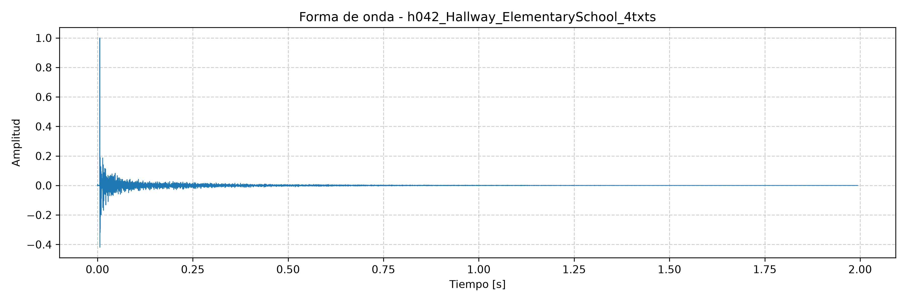

La representación temporal permite observar la señal original y su evolución a lo largo de la duración de la respuesta al impulso.

**Espectro de magnitud**

`docs/m2/espectro_h042_Hallway_ElementarySchool_4txts.png`

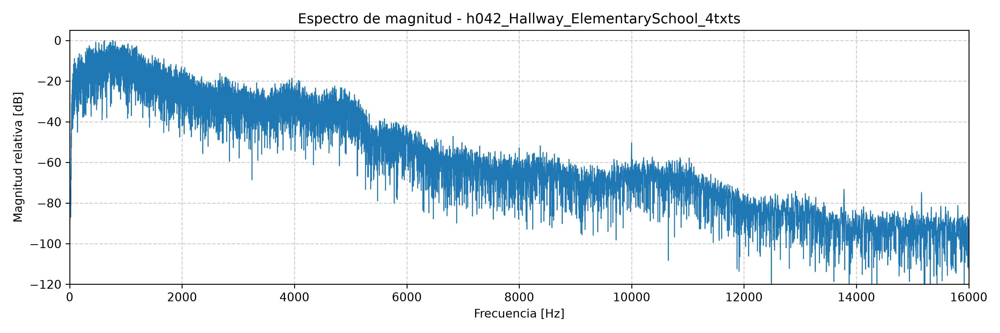

El espectro muestra la distribución de magnitud en frecuencia hasta la frecuencia de Nyquist (16 kHz). Se observa una disminución de la magnitud hacia las frecuencias altas.

**Procesamiento multibanda**

`docs/m2/val_multiband_h042_Hallway_ElementarySchool_4txts.png`

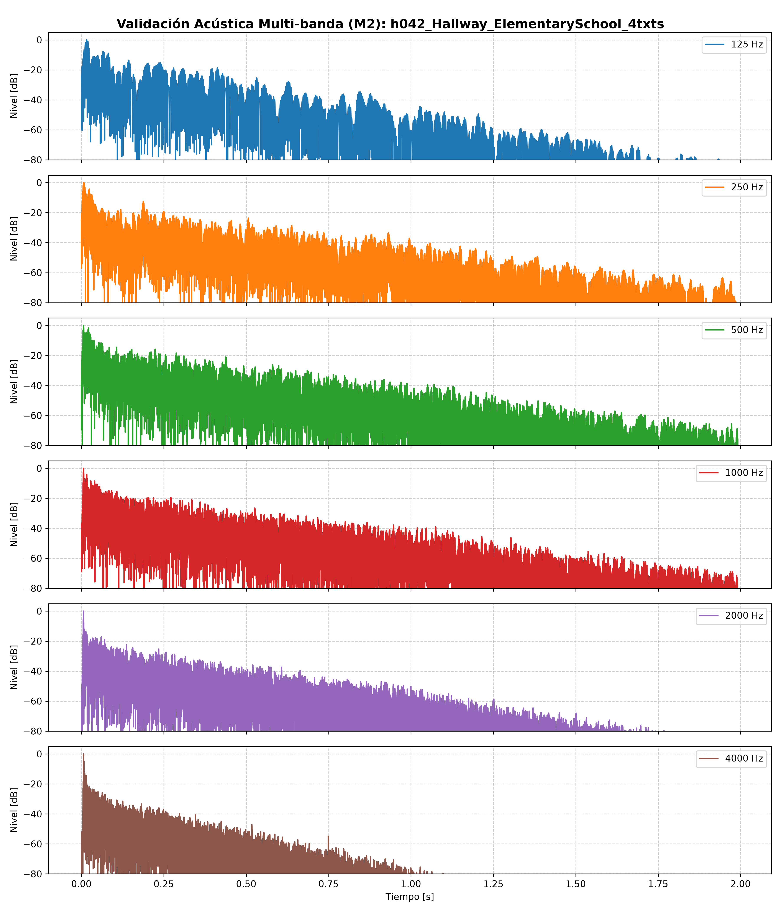

El gráfico permite comparar la evolución temporal de las señales filtradas en las seis bandas centrales. Las diferencias entre las trazas permiten inspeccionar el comportamiento de la respuesta al impulso según la frecuencia.

**Referencia externa REW**

`docs/m2/Hallway_ElementarySc_RT60_REW.png`

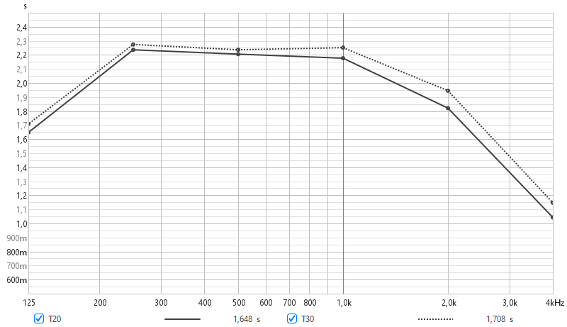

El gráfico presenta los valores de T20 y T30 obtenidos mediante REW. Se conserva como referencia externa para futuras comparaciones.

---

#### B. Livingroom (h045)

**Forma de onda**

`docs/m2/forma_onda_h045_Livingroom_4txts.png`

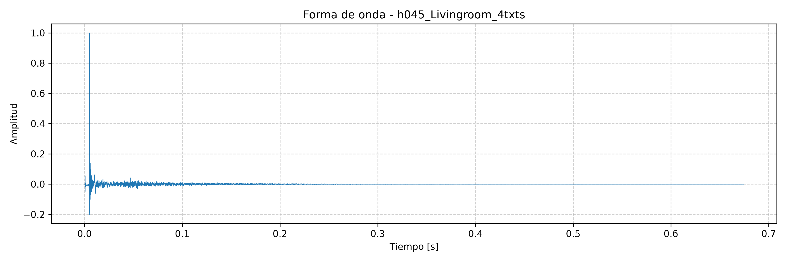

La representación temporal permite observar la señal original y su evolución a lo largo de la duración de la respuesta al impulso.

**Espectro de magnitud**

`docs/m2/espectro_h045_Livingroom_4txts.png`

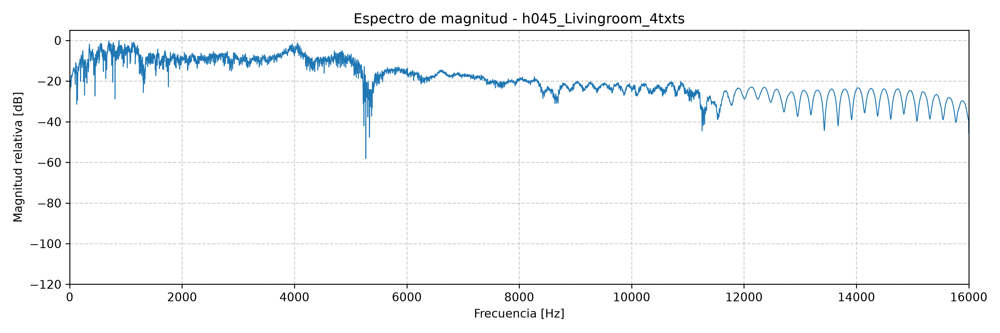

El espectro muestra la distribución de magnitud en frecuencia hasta la frecuencia de Nyquist (16 kHz). Se observa una disminución de la magnitud hacia las frecuencias altas.

**Procesamiento multibanda**

`docs/m2/val_multiband_h045_Livingroom_4txts.png`

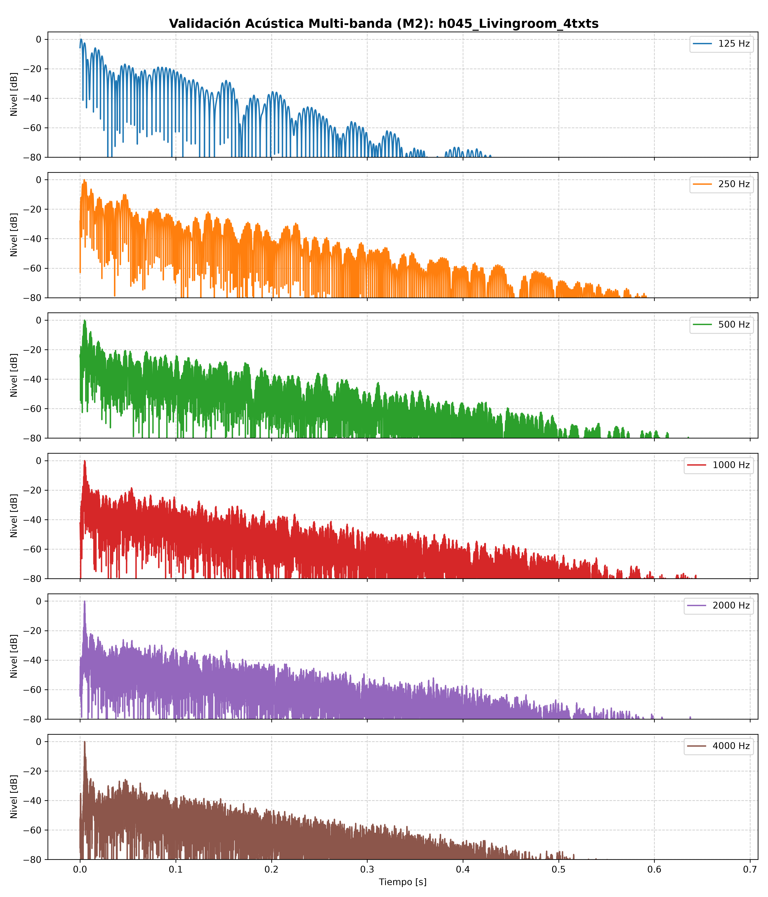

El gráfico permite comparar la evolución temporal de las señales filtradas en las seis bandas centrales. Se pueden observar las diferencias de comportamiento entre las bandas de frecuencia.

**Referencia externa REW**

`docs/m2/h045_Livingroom_4txts_RT60_REW.png`

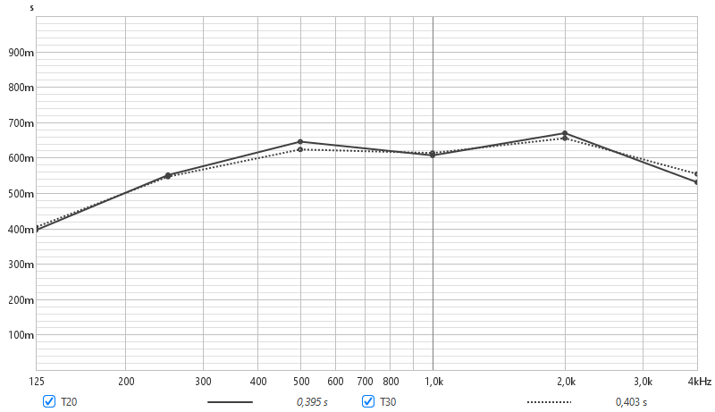

El gráfico presenta los valores de T20 y T30 obtenidos mediante REW. Se conserva como referencia externa para futuras comparaciones.

---

### 3. Validación de recuperación de una RI sintética

Se verificó el procedimiento de recuperación de respuestas al impulso mediante una prueba con una RI sintética conocida. Esta prueba está implementada en `tests/test_procesamiento.py`, en la función `test_impulse_response_peak()`.

El procedimiento consiste en:

1. Generar una RI sintética de 0,5 segundos, compuesta por un impulso directo y una cola exponencial, filtrada entre 100 Hz y 10 kHz.
2. Generar un *sine sweep* de 2 segundos, con frecuencias comprendidas entre 20 Hz y 20 kHz, junto con su filtro inverso.
3. Simular una grabación mediante la convolución del sweep con la RI original.
4. Recuperar la respuesta al impulso mediante `get_impulse_response()`, utilizando la grabación simulada y el filtro inverso.
5. Alinear la RI recuperada con la original mediante correlación cruzada y comparar el tramo superpuesto.

**Criterio de aceptación:** el valor absoluto del coeficiente de correlación entre ambas señales debe ser superior a 0,9.

**Resultado de la ejecución:**

```text
uv run pytest tests/test_procesamiento.py::test_impulse_response_peak -v

1 passed in 1.48s
```

La prueba verifica que el procedimiento de deconvolución permite recuperar una respuesta al impulso suficientemente similar a la original, considerando la alineación temporal.

#### Validación del decaimiento de una RI sintética

También se verificó que el procedimiento de generación de respuestas al impulso sintéticas produzca un decaimiento compatible con el tiempo de reverberación especificado. Esta prueba está implementada en `tests/test_procesamiento.py`, en la función `test_synthetic_ir_decay()`.

El procedimiento consiste en:

1. Generar una RI sintética de 6 segundos, con una frecuencia de muestreo de 44.100 Hz y un T60 esperado de 2 segundos en la banda de 1 kHz.
2. Filtrar la señal en la banda de octava centrada en 1 kHz.
3. Obtener la curva de decaimiento mediante el método de Schroeder.
4. Estimar el T60 a partir de dicha curva y compararlo con el valor esperado.

**Criterio de aceptación:** el T60 medido debe diferir como máximo un 10 % del valor esperado de 2 segundos, por lo que debe encontrarse entre 1,8 y 2,2 segundos.

**Resultado de la ejecución:**

```text
uv run pytest tests/test_procesamiento.py::TestGenerateSyntheticIR::test_synthetic_ir_decay -v

1 passed in 1.54s
```

La prueba confirma que la RI sintética presenta un decaimiento compatible con el T60 configurado, dentro de la tolerancia establecida.

### 4. Validación con la API de referencia de la cátedra

Para validar las respuestas al impulso utilizadas en M2, se enviaron los archivos `h042_Hallway_ElementarySchool_4txts.wav` y `h045_Livingroom_4txts.wav` a la API de referencia de la cátedra, mediante el endpoint:

`POST /api/v1/acoustics/parameters/bands`

La solicitud se realizó utilizando el campo multipart/form-data `file`, enviando cada archivo WAV por separado. Las respuestas completas del servicio se conservaron en formato JSON:

- `docs/m2/referencia_h042.json`
- `docs/m2/referencia_h045.json`

Cada respuesta incluye información del archivo procesado, la configuración del análisis, las frecuencias centrales evaluadas y los parámetros acústicos calculados por banda: $T_{30}$, $T_{20}$, $T_{10}$ y EDT.

A continuación, se resumen los valores de $T_{30}$ devueltos por la API de referencia para las seis frecuencias centrales utilizadas en nuestro análisis M2:

| Frecuencia (Hz) | h042 - Hallway (s) | h045 - Livingroom (s) |
| :---: | :---: | :---: |
| 125 | 1,566 | 0,364 |
| 250 | 2,042 | 0,492 |
| 500 | 1,990 | 0,554 |
| 1000 | 2,039 | 0,531 |
| 2000 | 1,723 | 0,535 |
| 4000 | 0,886 | 0,438 |

**Alcance de esta validación:** estos valores corresponden a las respuestas obtenidas del servicio de referencia de la cátedra. Los archivos JSON conservan los resultados completos para cada frecuencia. Esta documentación no implica que nuestra implementación local ya reproduzca dichos valores; la comparación numérica entre ambos servicios requiere evaluar las respuestas de nuestra propia API.

### 5. Valores de Referencia para la Validación

Se presentan los tiempos de reverberación $T_{30}$ obtenidos mediante REW para las respuestas al impulso de los recintos *Hallway* y *Livingroom*.

Estos valores se utilizan como referencia externa para la validación del sistema. En M2 se realizó un análisis gráfico del decaimiento energético por bandas de octava, pero todavía no se implementó el cálculo numérico de los tiempos de reverberación mediante la integral de Schroeder.

| Recinto | Banda (Hz) | $T_{30}$ REW (Referencia) |
| :--- | :---: | :---: |
| **Hallway** | 125 | 1,708 s |
| **Hallway** | 250 | 2,274 s |
| **Hallway** | 500 | 2,237 s |
| **Hallway** | 1000 | 2,252 s |
| **Hallway** | 2000 | 1,945 s |
| **Hallway** | 4000 | 1,147 s |
| **Livingroom** | 125 | 0,403 s |
| **Livingroom** | 250 | 0,546 s |
| **Livingroom** | 500 | 0,623 s |
| **Livingroom** | 1000 | 0,613 s |
| **Livingroom** | 2000 | 0,655 s |
| **Livingroom** | 4000 | 0,554 s |

**Alcance de la validación:** Los valores de esta tabla corresponden exclusivamente a REW y no representan resultados calculados por nuestra API.

La comparación numérica entre ambos sistemas se realizará en M3, mediante la implementación de la integral de Schroeder, el cálculo de los parámetros acústicos y su contrastación con los resultados de referencia.

## Validación M3 · Parámetros acústicos por banda

### Objetivo y alcance

La validación del **Milestone 3 (M3)** tiene como objetivo verificar el funcionamiento de la cadena completa de procesamiento acústico desarrollada en **RIR-API**, integrando las funcionalidades implementadas durante M1, M2 y M3.

El procedimiento comprende la carga de respuestas al impulso (RI), el filtrado en bandas de octava, la aplicación de la **integral de Schroeder** y el análisis del decaimiento energético mediante regresión lineal, permitiendo estimar los parámetros acústicos **EDT, T10, T20, T30, D50 y C80**, siguiendo los métodos establecidos en la norma **ISO 3382-1**.

Para garantizar la reproducibilidad de los resultados, las mediciones se realizaron a través del endpoint `POST /api/v1/acoustics/parameters`, utilizando `TestClient` de FastAPI. La ejecución de las pruebas, la comparación con los valores de referencia y la generación de las evidencias gráficas se encuentran automatizadas mediante el script [`docs/m3/validar_m3.py`](docs/m3/validar_m3.py).

### Señales y método

Se reutilizaron dos RI del MIT IR Survey
(<https://mcdermottlab.mit.edu/Reverb/IR_Survey.html>),
ya utilizadas en M2, sin modificar sus muestras originales:

- **Hallway Elementary School (h042):**
  `docs/m2/h042_Hallway_ElementarySchool_4txts.wav`,
  32000 Hz y aproximadamente 1,994 s.
- **Livingroom (h045):** `docs/m2/h045_Livingroom_4txts.wav`,
  32000 Hz y aproximadamente 0,675 s.
- **Sintética:** `generate_synthetic_ir(duration=5, fs=44100)`, con T60 configurado
  por banda en `docs/m3/validar_m3.py` (semilla fija en el generador).

Cada RI se analiza en 125, 250, 500, 1000, 2000 y 4000 Hz.
Los intervalos de regresión de la curva de Schroeder son EDT: 0 a −10 dB,
T10: −5 a −15 dB, T20: −5 a −25 dB y T30: −5 a −35 dB;
el tiempo se extrapola mediante `−60 / pendiente`.
Los resultados dependen de la referencia temporal elegida para el sonido directo,
del filtrado, del ruido de fondo y de la linealidad del decaimiento.

Los valores de REW son las **tablas A y B transcritas en el README de M2**.
No se utilizaron los archivos `referencia_h042.json` y `referencia_h045.json` de M2
como referencias REW: esos pertenecen a la API de la cátedra.

### Criterios de evaluación

EDT, T20 y T30: tolerancia de `min(10 % × |valor REW|, 0,5 s)`.
C80: diferencia absoluta máxima de 1 dB. Las mediciones `None` cuentan como
**no calculadas**, no como aciertos. D50 se informa frente a REW, pero sin
veredicto de tolerancia porque la consigna no especifica un umbral para D50.
T10 se calcula y exporta a JSON, pero no tiene referencia REW en estas tablas.

### 1. Validación con RI sintética

Se analizaron tiempos de reverberación conocidos por banda (segundos):

| Banda (Hz) | T60 configurado | EDT API | T20 API | T30 API |
|---:|---:|---:|---:|---:|
| 125 | 2.000 | 1.879 | 1.934 | 2.033 |
| 250 | 1.800 | 1.679 | 1.759 | 1.776 |
| 500 | 1.500 | 1.602 | 1.575 | 1.568 |
| 1000 | 1.200 | 1.059 | 1.281 | 1.253 |
| 2000 | 1.000 | 0.994 | 1.022 | 1.019 |
| 4000 | 0.800 | 0.834 | 0.805 | 0.811 |

La RI sintética permite comprobar la recuperación de T20 y T30 frente a un
tiempo configurado; EDT puede diferir por la estructura del decaimiento inicial.

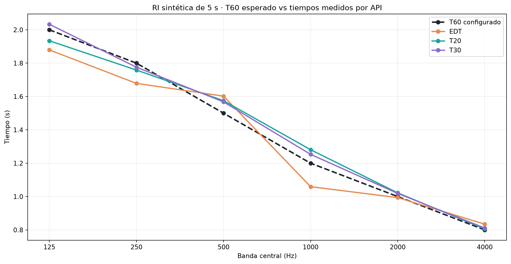

### 2. Hallway (h042) — resultados por banda

| Parámetro / banda (Hz) | 125 | 250 | 500 | 1000 | 2000 | 4000 |
|---|---:|---:|---:|---:|---:|---:|
| EDT (s) · RIR-API | 1.502 | 1.859 | 1.222 | 1.207 | 0.964 | 0.099 |
| EDT (s) · REW | 1.400 | 1.523 | 1.204 | 1.186 | 0.904 | 0.087 |
| T20 (s) · RIR-API | 1.589 | 2.219 | 2.172 | 2.178 | 1.826 | 1.011 |
| T20 (s) · REW | 1.648 | 2.236 | 2.205 | 2.177 | 1.821 | 1.043 |
| T30 (s) · RIR-API | 1.662 | 2.291 | 2.202 | 2.253 | 1.953 | 1.103 |
| T30 (s) · REW | 1.708 | 2.274 | 2.237 | 2.252 | 1.945 | 1.147 |
| C80 (dB) · RIR-API | 6.939 | 7.332 | 7.088 | 5.943 | 7.170 | 16.588 |
| C80 (dB) · REW | 6.900 | 7.720 | 7.400 | 6.480 | 8.890 | 16.620 |
| D50 (%) · RIR-API | 68.126 | 81.459 | 76.572 | 71.680 | 76.762 | 96.554 |
| D50 (%) · REW | 68.500 | 82.100 | 78.100 | 74.300 | 83.300 | 96.600 |

**Resultado:** 21/24 comparaciones dentro de tolerancia; 3 fuera y 0 `None`.

| Parámetro | Dentro de tolerancia | Fuera | None |
|---|---:|---:|---:|
| EDT | 4/6 | 2 | 0 |
| T20 | 6/6 | 0 | 0 |
| T30 | 6/6 | 0 | 0 |
| C80 | 5/6 | 1 | 0 |

#### Curva de Schroeder y regresiones (1000 Hz)

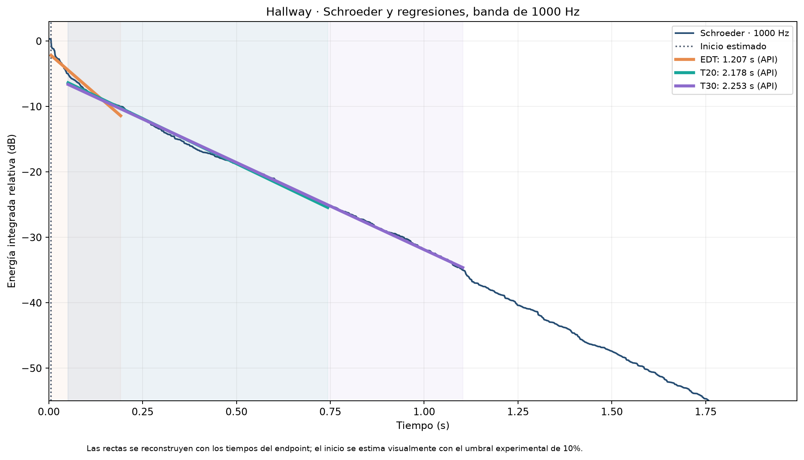

El gráfico muestra la curva de energía integrada y las rectas reconstruidas
con los tiempos informados por el endpoint. **La detección de inicio y la
normalización usadas para dibujar la figura son una reconstrucción diagnóstica**
de la variante experimental (umbral del 10 %); la respuesta JSON del endpoint
es la fuente de verdad para las tablas y el cumplimiento.

#### Comparación de filtros por bandas

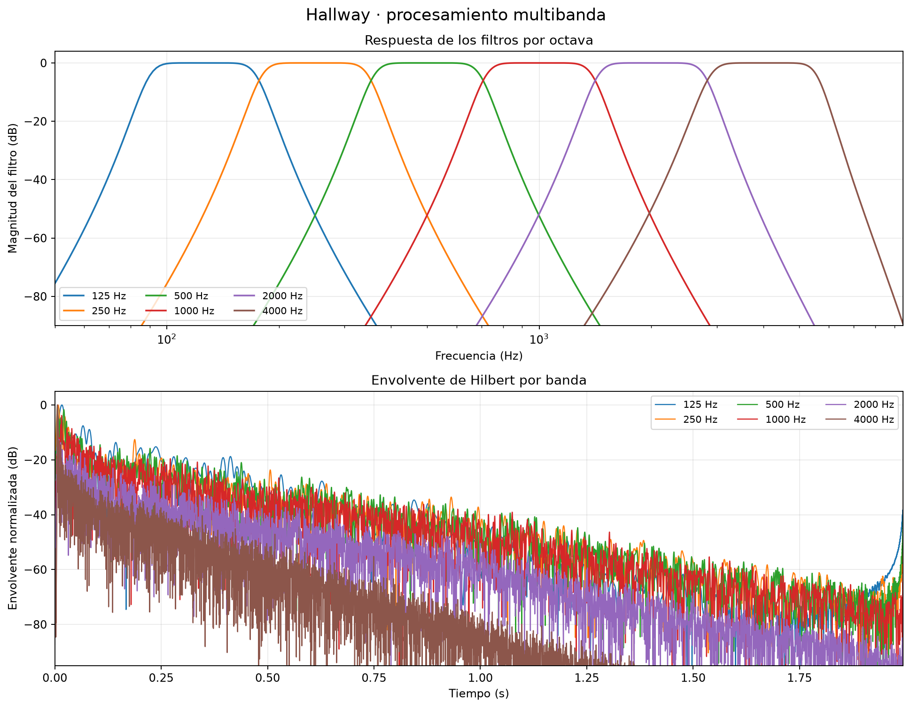

Se muestra la respuesta en frecuencia de filtros Butterworth y la envolvente
de Hilbert de las seis bandas de octava. La envolvente es descriptiva,
no se usa para sustituir la energía cuadrática de Schroeder.

#### Comparación RIR-API vs. REW

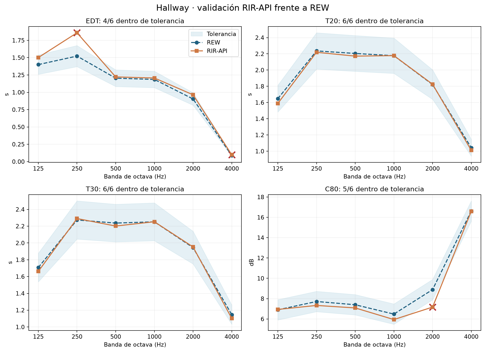

La franja sombreada indica tolerancia según la consigna; las cruces
rojas señalan mediciones fuera del intervalo de aceptación.

Tabla detallada de las 24 comparaciones: [`docs/m3/h042_comparacion_detallada.md`](docs/m3/h042_comparacion_detallada.md).

### 2. Livingroom (h045) — resultados por banda

| Parámetro / banda (Hz) | 125 | 250 | 500 | 1000 | 2000 | 4000 |
|---|---:|---:|---:|---:|---:|---:|
| EDT (s) · RIR-API | 0.182 | 0.475 | 0.137 | 0.196 | 0.004 | 0.009 |
| EDT (s) · REW | 0.242 | 0.331 | 0.109 | 0.120 | 0.007 | 0.008 |
| T20 (s) · RIR-API | 0.398 | 0.552 | 0.666 | 0.600 | 0.674 | 0.527 |
| T20 (s) · REW | 0.395 | 0.551 | 0.645 | 0.606 | 0.669 | 0.530 |
| T30 (s) · RIR-API | 0.393 | 0.538 | 0.637 | 0.614 | 0.659 | 0.547 |
| T30 (s) · REW | 0.403 | 0.546 | 0.623 | 0.613 | 0.655 | 0.554 |
| C80 (dB) · RIR-API | 11.734 | 13.699 | 13.705 | 14.905 | 16.999 | 20.081 |
| C80 (dB) · REW | 14.280 | 16.410 | 15.370 | 15.990 | 18.530 | 20.970 |
| D50 (%) · RIR-API | 88.478 | 92.265 | 93.242 | 93.905 | 96.445 | 97.793 |
| D50 (%) · REW | 92.800 | 95.700 | 95.500 | 95.400 | 97.500 | 98.200 |

**Resultado:** 13/24 comparaciones dentro de tolerancia; 11 fuera y 0 `None`.

| Parámetro | Dentro de tolerancia | Fuera | None |
|---|---:|---:|---:|
| EDT | 0/6 | 6 | 0 |
| T20 | 6/6 | 0 | 0 |
| T30 | 6/6 | 0 | 0 |
| C80 | 1/6 | 5 | 0 |

#### Curva de Schroeder y regresiones (1000 Hz)

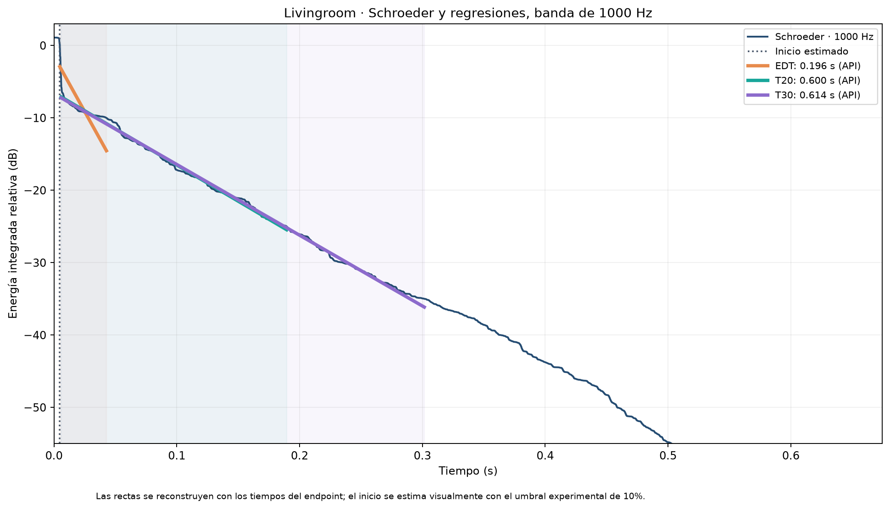

El gráfico muestra la curva de energía integrada y las rectas reconstruidas
con los tiempos informados por el endpoint. **La detección de inicio y la
normalización usadas para dibujar la figura son una reconstrucción diagnóstica**
de la variante experimental (umbral del 10 %); la respuesta JSON del endpoint
es la fuente de verdad para las tablas y el cumplimiento.

#### Comparación de filtros por bandas

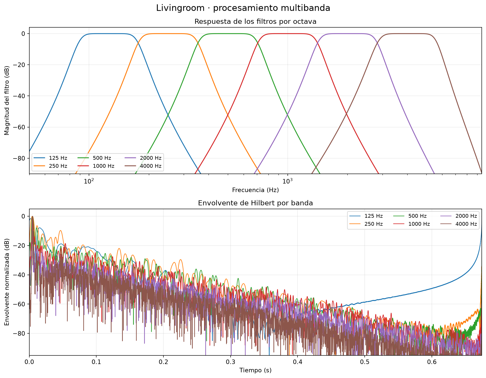

Se muestra la respuesta en frecuencia de filtros Butterworth y la envolvente
de Hilbert de las seis bandas de octava. La envolvente es descriptiva,
no se usa para sustituir la energía cuadrática de Schroeder.

#### Comparación RIR-API vs. REW

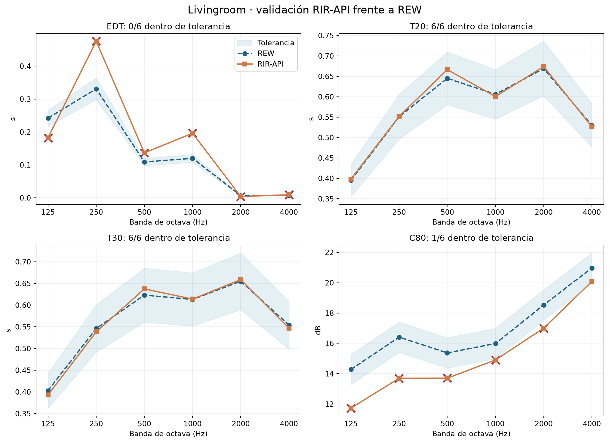

La franja sombreada indica tolerancia según la consigna; las cruces
rojas señalan mediciones fuera del intervalo de aceptación.

Tabla detallada de las 24 comparaciones: [`docs/m3/h045_comparacion_detallada.md`](docs/m3/h045_comparacion_detallada.md).

### 3. Evaluación global y limitaciones

Sobre **48** comparaciones evaluables (2 recintos × 6 bandas × 4 parámetros),
**34 cumplen**, **14** están fuera de tolerancia y
**0** no se calcularon.

La integral de Schroeder y los tiempos de decaimiento T20/T30 muestran
una buena concordancia en estas RI, pero EDT es sensible al instante
directo y al comportamiento no lineal de los primeros 10 dB; C80 es
sensible a la división de energía a 80 ms. Un R² bajo no demuestra por
sí solo una medición imposible: el criterio experimental genera una
advertencia y conserva el valor si hay rango dinámico, puntos y pendiente válidos.
No se ajustaron parámetros para forzar coincidencia con REW y las
discrepancias se publican explícitamente.

**Alcance:** se documenta la conformidad frente a las tolerancias de la
consigna en estos archivos de prueba; no constituye una certificación de
conformidad de todas las mediciones posibles con ISO 3382.

### 4. Reproducibilidad y pruebas

Desde la raíz del repositorio, con el entorno configurado:

```powershell
python docs/m3/validar_m3.py
python -m pytest -v
python -m ruff check .
```

El script procesa los WAV de `docs/m2/` y escribe en `docs/m3/` los
gráficos, tablas, JSON, CSV y este fragmento del README. No modifica
ni los audios originales ni el algoritmo de los servicios.

Para probar la API manualmente: `python -m uvicorn app.main:app --reload`
y subir una RI desde `http://127.0.0.1:8000/docs`.

## Tests

Las funciones de `app/services/` vienen como *stubs* que lanzan `NotImplementedError`. Sus
tests estan marcados como `xfail` (fallo esperado), asi el CI queda en verde desde el
primer dia:

- Mientras la funcion no este implementada, el test aparece como `x` (xfailed).
- Cuando la implementen bien, aparece como `X` (xpassed). En ese momento conviene **borrar
  la marca `xfail`** del modulo de tests (`pytestmark = ...`) para que el test cuente como
  un test normal. En `tests/test_api.py` la marca va test por test (`@xfail_m1`,
  `@xfail_m2`, `@xfail_m3`): borren la de cada endpoint que implementen.
- Si la implementacion es incorrecta, el test **falla** (rojo) con el `AssertionError`.

```bash
uv run pytest                                  # todos los tests
uv run pytest -v tests/test_generacion.py      # un archivo, con detalle
uv run pytest -v -k pink_noise                 # tests cuyo nombre contiene "pink_noise"
uv run pytest -rxX                             # listar xfailed / xpassed
uv run pytest --cov=app                        # con cobertura
```

`play_and_record` se testea con un *mock* de `sounddevice`, por lo que el CI no necesita
placa de audio. Para probarla de verdad, corran la funcion localmente con un parlante y un
microfono y documenten la configuracion (dispositivo, canales, fs, buffer size).

## Linter y formato

```bash
uv run ruff check app/ tests/          # verificar estilo
uv run ruff check --fix app/ tests/    # corregir lo automatico
uv run ruff format app/ tests/         # formatear
```

El CI (`.github/workflows/ci.yml`) corre `ruff check`, `ruff format --check` y
`pytest --cov=app` en cada push a `main` y en cada pull request.

## Configuracion

`app/settings.py` define la configuracion con `pydantic-settings`. Cualquier valor se puede
sobreescribir con variables de entorno con prefijo `RIR_` (por ejemplo `RIR_FS_DEFAULT=44100`)
o con un archivo `.env` en la raiz (ignorado por git).

## Referencias

- ISO 3382-1:2009 — Acoustics — Measurement of room acoustic parameters.
- Farina, A. (2000). *Simultaneous measurement of impulse response and distortion with a
  swept-sine technique.* 108th AES Convention.
- Schroeder, M. R. (1965). *New method of measuring reverberation time.* JASA 37(3).
- [FastAPI](https://fastapi.tiangolo.com/) · [Pydantic](https://docs.pydantic.dev/) ·
  [uv](https://docs.astral.sh/uv/)
